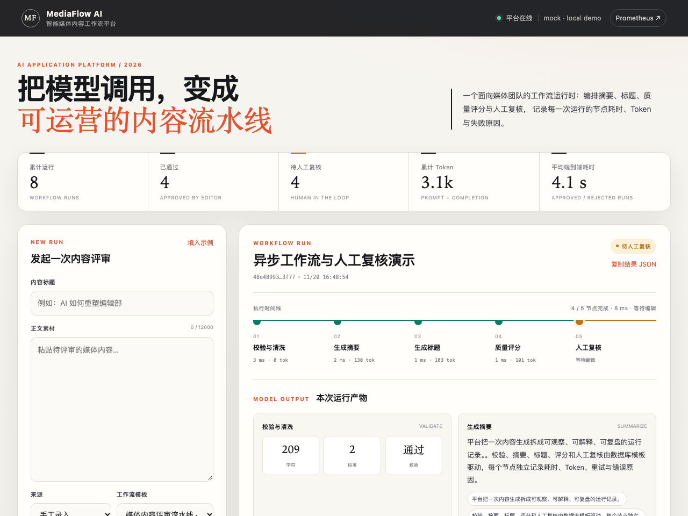
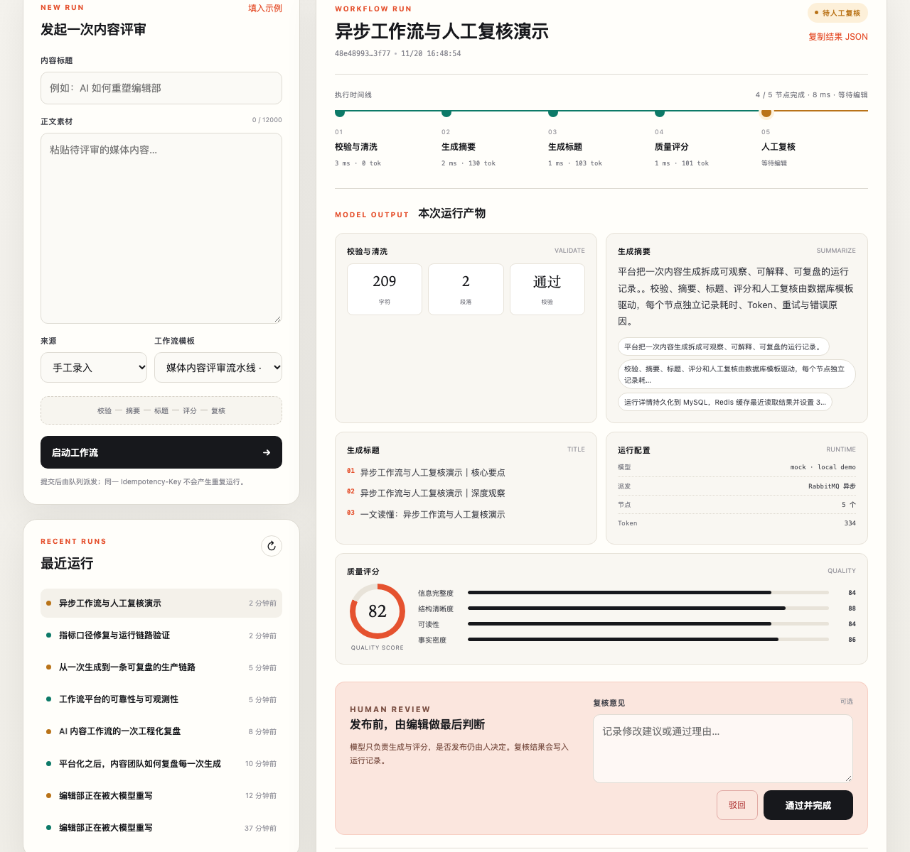
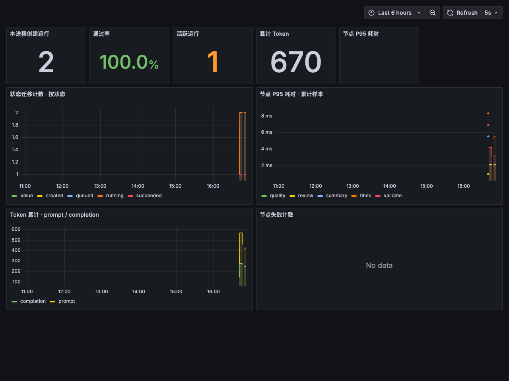
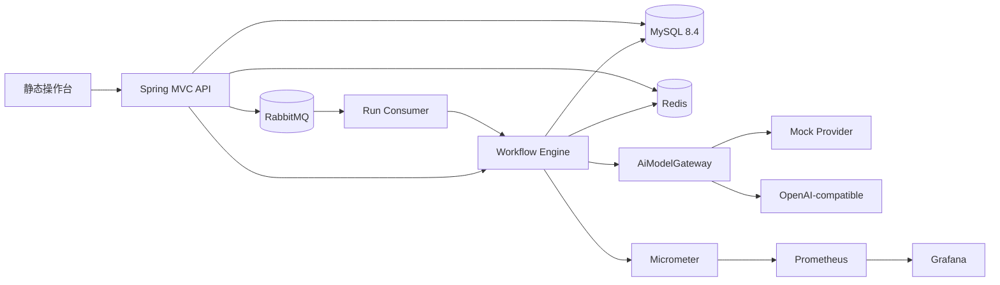

# MediaFlow AI

[](https://github.com/StewardAndrecher/mediaflow-ai/actions/workflows/ci.yml)

面向智能媒体内容的 AI 工作流平台：把摘要、标题、质量评分与人工复核编排成可观测、可重试、可复盘的运行时。



> 默认使用 `mock` 模型，无 API Key 也能完整跑通。模型适配层同时支持 OpenAI-compatible 接口，可通过环境变量切换。

## 为什么做这个

把一次大模型调用接进业务并不难，难的是让它成为可以长期运行的内容生产流程：请求重复、上游超时、节点失败、摘要与标题风格漂移、人工复核不可追踪、Token 成本无人核算。

MediaFlow AI 用一条五节点工作流把这些工程问题显式化：

```
校验与清洗 → 生成摘要 → 生成标题 → 质量评分 → 人工复核
```

每次运行都会持久化节点状态、耗时、Token 与错误原因，并向 Prometheus 暴露指标。

## 核心能力

- **定义驱动的工作流**：节点、顺序、超时、最大重试次数存放在 MySQL，不写死在业务代码里。
- **模型输出约束**：摘要、标题与质量评分在写入节点前校验 JSON 结构、必需字段和分值范围；不合格输出进入失败重试，不污染运行记录。
- **同步 / 异步双模式**：`QUEUE_ENABLED=false` 时请求线程直接执行，便于本地调试；`true` 时由 RabbitMQ 消费并异步派发。
- **幂等创建**：`Idempotency-Key` 唯一约束，重复提交返回同一 `runId`，不重复消耗模型调用。
- **节点级容错**：每个模型节点独立超时与重试，失败写入节点状态、错误信息和失败指标。
- **Human-in-the-loop**：模型完成后进入 `WAITING_REVIEW`，编辑通过或驳回后才结束运行。
- **可观测**：Micrometer 暴露运行创建、状态迁移、节点耗时、Token、失败次数与活跃运行数；Prometheus 抓取，Grafana 预置看板。
- **缓存降级**：Redis 缓存运行详情 30 秒；Redis 不可用时自动回源 MySQL，不影响主流程。
- **一键启动**：Docker Compose 编排应用、MySQL、Redis、RabbitMQ、Prometheus 与 Grafana。
- **持续集成**：GitHub Actions 运行 `./mvnw verify`，同时校验 Java 格式与后端测试。

## 界面

控制台同时承担“发起运行”和“排查运行”两件事：左侧提交素材，右侧展示五节点时间线、模型产物与复核入口。

人工复核不是弹窗式按钮，而是一段明确的运行状态：复核意见和通过 / 驳回结果都会写入节点记录。



Grafana 看板展示本进程创建运行、通过率、活跃运行、Token、节点 P95 耗时与失败计数。



控制台的累计运行来自 MySQL 全量记录；Prometheus Counter 随应用进程重启归零，因此看板的“本进程创建运行”可能小于控制台历史总数。

## 架构



### 技术选型

| 层 | 选型 | 原因 |
|---|---|---|
| 应用 | Java 17 + Spring Boot 4.1.1 | 岗位明确接受 Java；Spring 生态适合平台型后端 |
| 数据访问 | Spring JDBC + Flyway | 工作流状态读写直接、SQL 可控，迁移可审计 |
| 数据库 | MySQL 8.4 | 运行与节点记录持久化，唯一约束保证幂等 |
| 缓存 | Redis | 运行详情短 TTL 缓存，故障自动降级 |
| 异步 | RabbitMQ | 解耦 API 与执行，验证队列消费链路 |
| 指标 | Micrometer + Prometheus + Grafana | 运行数、耗时、Token、失败原因统一观测 |
| 前端 | 原生 HTML / CSS / JS | 本岗位重点在平台后端，不引入额外前端构建链 |
| 交付 | Docker Compose | 一条命令拉起完整依赖与可观测栈 |

## 快速开始

### 方式一：Docker Compose 一键启动

```bash
cp .env.example .env
docker compose up -d --build
```

启动后：

| 服务 | 地址 | 默认账号 |
|---|---|---|
| MediaFlow 控制台 | http://localhost:8090 | 无 |
| Prometheus | http://localhost:9091 | 无 |
| Grafana | http://localhost:3002 | `admin` / `mediaflow` |
| RabbitMQ 管理台 | http://localhost:15680 | `mediaflow` / `mediaflow-demo` |
| MySQL | `localhost:3308` | `mediaflow` / `mediaflow-demo` |
| Redis | `localhost:6381` | 无密码 |

停止：

```bash
docker compose down
```

清空数据并重建：

```bash
docker compose down -v
```

### 方式二：本地开发

要求 JDK 17、Maven 3.9+；依赖可用 Docker 启动。

```bash
cp .env.example .env
docker compose up -d mysql redis rabbitmq
JAVA_HOME=/path/to/jdk-17 ./mvnw spring-boot:run
```

默认配置连接 `localhost:3308 / 6381 / 5680`，应用端口 `8090`。`QUEUE_ENABLED` 默认 `false`，可直接同步执行。

### 接入真实模型

```bash
AI_PROVIDER=openai
LLM_BASE_URL=https://api.openai.com/v1
LLM_API_KEY=sk-...
LLM_MODEL=gpt-4.1-mini
```

`LLM_BASE_URL` 填 OpenAI-compatible 服务的 `/v1` 根路径，适配器会调用 `/chat/completions`。没有 Key 时保持 `mock`，界面会标记 `mock · local demo`，不宣称真实模型效果。

## 工作流定义

内置模板 `tpl_media_review_v1`：

| 顺序 | node_key | 类型 | 行为 | 超时 | 重试 |
|---|---|---|---|---|---|
| 1 | `validate` | `VALIDATE` | 校验空内容、长度上限，统计字符与段落 | 10s | 1 |
| 2 | `summary` | `SUMMARIZE` | 生成摘要与关键点 | 30s | 2 |
| 3 | `titles` | `TITLE` | 基于摘要生成三版标题 | 30s | 2 |
| 4 | `quality` | `QUALITY` | 输出评分、维度分与问题列表 | 30s | 2 |
| 5 | `review` | `HUMAN_REVIEW` | 进入待复核，由编辑通过或驳回 | 60s | 1 |

运行状态：

```
QUEUED → RUNNING → WAITING_REVIEW → SUCCEEDED
                              └──→ REJECTED
                 └──→ FAILED
```

节点状态：

```
PENDING → RUNNING → WAITING_REVIEW → SUCCEEDED
                 └──→ FAILED
```

## API

| 方法 | 路径 | 说明 |
|---|---|---|
| `GET` | `/api/templates` | 查询模板与节点定义 |
| `GET` | `/api/runtime` | 模型模式、队列开关、平台标识 |
| `POST` | `/api/runs` | 创建运行，支持 `Idempotency-Key` 请求头 |
| `GET` | `/api/runs?limit=30` | 最近运行列表 |
| `GET` | `/api/runs/{runId}` | 运行详情、节点时间线、模型输出 |
| `POST` | `/api/runs/{runId}/review` | 人工复核 `{ "approved": true, "comment": "..." }` |
| `GET` | `/api/metrics` | 聚合指标摘要 |
| `GET` | `/actuator/health` | 健康检查 |
| `GET` | `/actuator/prometheus` | Prometheus 指标 |

创建运行：

```bash
curl -X POST http://localhost:8090/api/runs \
  -H 'Content-Type: application/json' \
  -H 'Idempotency-Key: demo-001' \
  -d '{
    "templateId": "tpl_media_review_v1",
    "title": "编辑部正在被大模型重写",
    "source": "manual",
    "content": "待评审的媒体正文……"
  }'
```

响应：

```json
{
  "runId": "76926224-2b3f-4d29-9948-01e70cee34ab",
  "status": "QUEUED",
  "replayed": false
}
```

相同 `Idempotency-Key` 再次提交返回 `replayed: true` 与同一 `runId`。

## 可靠性设计

- **幂等**：`workflow_runs.idempotency_key` 唯一约束，应用层先查后插，并捕获并发重复插入。
- **重试**：节点从模板读取 `max_attempts`，模型异常按 250ms、500ms 退避重试；校验类错误不重试。
- **超时**：节点在独立线程池执行，`Future.get(timeoutSeconds)` 超时后取消并记为失败。
- **人工复核**：通过或驳回结果写回 `review` 节点与运行记录，状态不可逆。
- **缓存降级**：Redis 读写在 `try/catch` 内，异常只记 debug 日志并回源 MySQL。
- **确定性演示**：Mock 模型使用固定评分规则与内容摘要，便于回归测试；不伪造真实模型效果。

## 可观测性

应用暴露的指标：

| 指标 | 类型 | 标签 |
|---|---|---|
| `ai_workflow_runs_total` | Counter | `template`, `status`（`created` 表示真实创建，其余为状态迁移） |
| `ai_workflow_run_duration_seconds` | Timer / Histogram | `template`, `status` |
| `ai_workflow_nodes_total` | Counter | `template`, `node`, `status` |
| `ai_workflow_node_duration_seconds` | Timer / Histogram | `template`, `node` |
| `ai_workflow_node_failures_total` | Counter | `template`, `node`, `reason` |
| `ai_workflow_tokens_total` | Counter | `type`, `node` |
| `ai_workflow_active_runs` | Gauge | 无 |

Grafana 预置看板 `MediaFlow AI · Workflow Runtime`，包含累计运行、通过率、活跃运行、Token 累计、节点 P95 耗时与失败计数。

### 已验证的观测链路

- Prometheus target `mediaflow-ai` 状态为 `up`。
- 查询 `sum(ai_workflow_runs_total{status="created"})` 返回真实创建次数；其余 `status` 记录状态迁移，不能直接求和当作运行数。
- 查询 `sum(ai_workflow_tokens_total)` 返回累计 Token；`histogram_quantile` 可计算节点 P95。
- Grafana 匿名 Viewer 可打开 `http://localhost:3002/d/mediaflow-runtime`，看板由 Provisioning 自动创建，不需要手工配置数据源。

## 项目结构

```text
mediaflow-ai/
├── src/main/java/com/mediaflow/
│   ├── MediaFlowApplication.java
│   └── workflow/
│       ├── AiModelGateway.java       # Mock + OpenAI-compatible 适配
│       ├── ApiExceptionHandler.java  # API 错误映射
│       ├── RunDispatcher.java        # 同步 / RabbitMQ 派发
│       ├── WorkflowController.java   # REST API
│       ├── WorkflowEngine.java       # 节点编排、超时、重试、复核
│       ├── WorkflowMetrics.java      # Micrometer 指标
│       ├── WorkflowModels.java       # 领域模型
│       ├── WorkflowRepository.java   # JDBC 仓储
│       ├── WorkflowRunCache.java     # Redis 缓存与降级
│       ├── WorkflowRunConsumer.java  # RabbitMQ 消费
│       └── WorkflowService.java      # 创建、查询、复核用例
├── src/main/resources/
│   ├── application.yml
│   ├── db/migration/V1__init.sql
│   └── static/                       # 操作台
├── src/test/                         # H2 + MockMvc 集成测试
├── ops/prometheus/prometheus.yml
├── ops/grafana/                      # 数据源与看板 Provisioning
├── compose.yaml
├── Dockerfile
└── docs/
```

## 验证记录

以下为 2026-11-20 本机实际执行结果，非估算：

- `./mvnw test`：**8 项通过，0 失败，0 错误，0 跳过**；覆盖创建运行、人工复核、幂等重放、空内容校验、404、模板查询、节点重试与结构化输出校验。
- `docker compose up -d --build`：app、MySQL、Redis、RabbitMQ、Prometheus、Grafana **六个容器均启动成功**，app 健康检查为 healthy。
- RabbitMQ 异步链路：创建返回 `QUEUED`；消费者处理 5 个节点后进入 `WAITING_REVIEW`，`validate / summary / titles / quality` 均为 `SUCCEEDED`。
- 人工复核：通过后运行变为 `SUCCEEDED`；样本记录 410 / 424 / 418 Token，首个样本运行跨度约 13.8 秒（包含人工等待）。
- Redis：读取运行详情后生成 `mediaflow:run:<id>`，TTL 为 30 秒；Redis 不可用时读取逻辑自动回源 MySQL。
- RabbitMQ：`mediaflow.workflow.runs` 队列消息数为 0，处理完成无堆积。
- Prometheus：target `mediaflow-ai` 为 `up`；`/actuator/prometheus` 返回创建次数、状态迁移、节点耗时与 Token 指标。
- Grafana：`/d/mediaflow-runtime` 返回 HTTP 200，匿名 Viewer 可访问，五个统计面板与四个时间序列面板均完成 Provisioning。
- Flyway：启动时成功应用 1 个迁移，版本 `v1`。
- 应用启动：Java 17 下约 1.7 秒完成启动。

## 边界与后续

当前版本是可运行的工程样本，不是生产级多租户平台：

- 只有一条种子模板，尚未提供可视化 DAG 编辑器。
- 默认为 Mock 模型；OpenAI-compatible 适配已实现，但因没有真实 API Key，未验证真实模型质量、延迟与 token 计费。
- 没有登录、权限、租户隔离、限流与审计。
- 人工复核固定为最后一个节点；运行耗时包含人工等待时间。
- 前端使用轮询刷新，未接 WebSocket / SSE。

下一步优先级：接入真实模型并建立小规模评测集 → 模板 CRUD 与 DAG 编辑 → SSE 实时状态 → 租户隔离与配额 → 失败节点手工重跑。

---

本项目用于 AI 应用平台方向的作品展示。默认演示数据与指标均可由仓库内代码复现。
